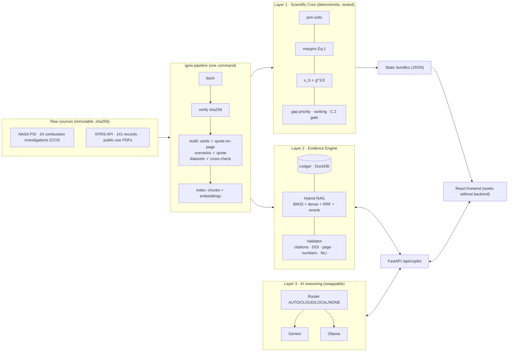

<p align="center"></p>

# IGNIS — Space Fire Intelligence

**NASA Space Apps Challenge 2026 · "Flame in Freefall: SI-Powered Fire Safety Insights from Microgravity Combustion Data"**
Team **Artisanal Intelligence** (Riobamba, Ecuador) · MIT license · not affiliated with or endorsed by NASA

> Fire depends on gravity. Crews will live at 0.165 g and 0.38 g, where the evidence is thinnest.
> IGNIS turns NASA's low-gravity combustion archive into traceable evidence. It shows what we know, how
> well a mission condition is covered, and **what to measure next**.

## The problem

Nearly all spacecraft-fire evidence comes from Earth (1 g) or orbit (~0 g). Artemis and Mars crews will live
at partial gravity, in reduced-pressure, oxygen-enriched cabins. NASA documents the lunar Surface Habitat at 10.2 psia
with 26.5% O₂, with an 8.2 psia / 34% O₂ capability (NASA/TM-20220000524). The 2006 Exploration Atmospheres Working
Group recommended 8.0 psia / 32% O₂ for long-duration lunar and Mars habitats (NTRS 20150021491).

### Thesis: the partial-gravity blind spot

We tested two hypotheses against sources. We did not assume them.

**H1: partial-gravity combustion data are scarce.** Holds, reformulated:

- 0 of NASA PSI's 24 combustion investigations are partial-gravity investigations (from PSI metadata).
- Our curated ledger holds 5 partial-gravity campaigns from 4 sources. Other registered studies, such as
  Konno et al. (2023), are not yet carded.
- The longest test lasted about 150 s (LUCI, spin-simulated); the rest are 5-s drop tests or ~25-s aircraft
  parabolas.
- Most results are only available as plots.

**H2: 1-g screening (NASA-STD-6001 Test 1) may not be conservative at low gravity.** Partially supported:

- Mylar, Ultem and Nomex all had negative oxygen margins at lunar and Martian gravity, down to −5.75 percentage
  points for Mylar at lunar g (Olson & Ferkul 2012).
- The charring Ultem film and Nomex fabric did not show this in 0 g (+0.25 and −0.3, within the 1% O₂ test step).
- The low-g limits come from 5.18-s drops. The 1-g limits come from a modified Test 1 (hot-wire igniter, limit
  search), not the standard pass/fail screening.
- Earlier NASA assessments judged Test 1 conservative for quiescent microgravity (Miller 2004; Golden 2007).
- "More flammable" means a lower O₂ limit, not faster spread.

## What IGNIS does

| Module | Status | What it does |
|---|---|---|
| **A · Evidence Explorer** | ✅ | 72 Finding Cards from NTRS documents. Each verbatim quote is verified on the cited page (3 cards against NTRS abstracts), and every number of the value must appear in the quote. Transparent ranking S = (M^a·E^b·R^c)^(1/Σw), with adjustable weights and a one-line explanation for each card. Also the PSI catalog (24 investigations). |
| **C.1 · Partial-Gravity Bridge** | ✅ | Flammability limits at 0, 0.165, 0.38 and 1 g, with comparability flags. Buoyant-velocity scaling u_b ∝ g^(1/3) places µg forced-flow tests on the gravity axis as anchor-dependent analogs (1-g anchors 20–35 cm/s across sources). |
| **E · Standards Stress-Test** | ✅ | Published oxygen margins, recomputed (9/9 match), with the H2 verdict and its caveats. |
| **F.1 · Gap Radar + Next-Experiment Designer** | ✅ | Gravity × O₂ × pressure coverage. P = R × 1/(1+n) × D × F, with the formula visible. Proposals sit in the cell that contains each mission's conditions, and documented FM2 plans are accounted for. |
| **G · Scientific Copilot** | ✅ | Hybrid RAG (BM25 + bge-small + RRF + cross-encoder) over ~18k passages. Core tools do the calculations; the Scientific Evidence Validator checks every sentence. Gemini, Ollama, or no LLM. |
| **B · Consensus & Contradiction** | ◐ curated | Two apparent contradictions, each explained by test conditions. |
| **C.2 · Predictor** | ⛔ gated | The pre-specified gate fails on the data: 2 of 3 partial-g test series (both from one apparatus), 8 of 20 points. No fire probabilities are shown anywhere. |
| **F.2 · Bayesian design** | ⛔ | Requires the C.2 predictor. A transparent priority formula is used instead. |
| D · Habitat Twin, H · Explainer, I · Earth Impact, paper | ⏳ | After the hackathon. |

### Answers to the challenge's three questions

1. **What do we know, and on what evidence?** Every claim shows its source, page, verbatim quote, data type
   (MEASURED / DERIVED / MODELED / CONCEPTUAL) and epistemic status (fact / interpretation / hypothesis /
   unknown).
2. **How well is a mission condition covered?** Pick a scenario (ISS, Gateway, lunar habitat, Mars). Its
   atmosphere is verified in NASA documents, or marked UNKNOWN. Then see the evidence and the comparability
   caveats.
3. **What should fly next?** Top gap: lunar gravity at the nominal lunar-habitat atmosphere (10.2 psia, 26.5% O₂). The only evidence in our ledger is a 5.18-s drop-tower limit series on two films; no long-duration test is in our ledger or planned in our sources (FM2 plans 8.2 psia/34% and 14.7 psia/21%).

## Architecture



- **Static-first.** Explorer, Bridge, Gap Radar and Methods run entirely from precomputed, verified JSON. The
  Copilot falls back to precomputed answers produced by the same pipeline, labeled as such.
- **The LLM never computes.** Numbers come from retrieved text or from Core tool results. The validator removes
  any sentence whose numbers cannot be traced.

## Data

See [DATA_SOURCES.md](DATA_SOURCES.md) for licenses and [submission/NASA_DATA.md](submission/NASA_DATA.md) for
links. In short:

- **PSI:** CC0 investigation metadata and experimental tables.
- **NTRS:** public-use PDFs are indexed. "May include copyright" PDFs are used only to verify quotes locally.
  Paywalled papers are used as metadata and short quotes only.

Data-quality problems found in the sources are listed in the app (Methods → Data quality). Examples: a
wrong burning-rate unit in the PSI FLEX table, and a figure caption inconsistent with its own Table I.

## Verification and metrics

See [TEST_REPORT.md](TEST_REPORT.md).

- Backend: pytest covers units (property-based), quote verification, the Table I recomputation, the analytics,
  the validator, prompt injection, 429/timeout/network failover, LOCAL and no-LLM modes. ruff and mypy
  `--strict` are clean.
- Frontend: TypeScript strict and eslint. Vitest checks parity between the Python Core and the browser mirror.
- Copilot: golden set of 25 questions, reporting abstention accuracy, citation correctness, validator acceptance
  and retrieval recall@8, each with Wilson 95% intervals.
- Local LLM hardware benchmark: [docs/hardware_report.md](docs/hardware_report.md).

## Run it

```bash
# backend (Python 3.11, uv)
cd backend
uv sync
uv run ignis-pipeline all                       # fetch → verify → build (cards, scenarios, analytics)
uv run python -m ignis.pipeline.index_build     # retrieval index (incremental)
uv run pytest
uv run uvicorn ignis.api.main:app --port 8000

# frontend (Node 22+)
cd ../frontend
npm install
npm run dev                                     # http://localhost:5173 (proxies /api to :8000)
```

Configuration: copy `.env.example` to `backend/.env`. Keys never reach the browser. With no key and no
Ollama, IGNIS still runs in "evidence only" mode.

## Honest limitations

- The ledger is curated for partial-gravity fire safety; it is not an exhaustive review. "No test in the ledger"
  does not prove that no test exists.
- Partial-gravity evidence is short-duration and from few materials. The u_b scaling is an order-of-magnitude
  analog, not a flow model.
- Ranking and priority weights are documented judgment calls, not fitted parameters.
- Finding Cards were drafted with AI assistance. They are accepted only by deterministic checks, and a human
  spot-check is reported in TEST_REPORT.md.
- The Copilot validator is conservative but not perfect: in the golden set, 41% of drafted sentences were
  verified by NLI and 52% were kept only as hypotheses. It has also removed correct sentences when the cited
  passage wrote a number differently.

## Use of AI (SI) tools

The code base, pipeline and documentation were produced with an AI coding agent (Claude Code), under the team's
direction. The idea and research questions are the team's own.

The logo SVG was produced with AI assistance. In-app language models (Gemini, or Ollama locally) only phrase
answers from retrieved evidence, and they never compute scientific values.
